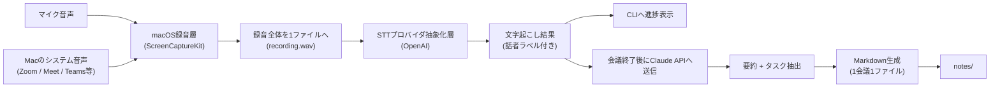

# 概要

ローカルで動かす前提で以下の機能を実装する。

```
会議の文字起こし → タスク分解 → Markdown
```

## 背景・課題感

Notta などの文字起こしSaaSは、

- 使用量に関わらず月額固定費がかかる
- 出力フォーマットが閉じていて、パーソナライズしにくい
- TODO/タスク管理を自分の運用（プロジェクトごとにGitHubでMarkdown管理し、AIに再利用させる）に組み込みにくい

という課題がある。会議を行う端末上でローカルに立ち上げ、STT・LLMは従量課金APIを叩く構成にすることで、固定費をかけずに自分のワークフローに最適化したツールを実現する。

## ゴール

1. Macで再生されるシステム音声とマイク音声を録音する
2. 録音を1本の音声ファイルとして保存し、終了後にまとめて文字起こしする
3. 会議終了後に文字起こし結果をLLMへ渡し、要約とタスクに分解する
4. 会議ごとにメタ情報付きで出力する
5. STT/LLMプロバイダを抽象化し、固定のベンダーロックインを避ける

## 全体アーキテクチャ



録音中は分割せず、会議全体を1本の音声ファイルとして保存する。録音を停止したあと、その1ファイルをまとめてSTTへ渡す。
文章の途中で切れないため、文字起こしの精度が落ちにくい。
ただしSTTモデルの上限（1回あたり1400秒）を超える録音は、無音位置で分割して順に渡すため、
話者ラベルは断片ごとに振り直される。
続けて文字起こし全文をClaude APIへ渡し、要約・タスク抽出とMarkdown出力を行う。

## 主要機能要件

### 1. 音声キャプチャ
- MVPはmacOS 15以降を対象とする
- Macで再生される全システム音声（Zoom / Google Meet / Microsoft Teams等）と、既定のマイク入力を1本の音声へミックスする
- macOS標準の`ScreenCaptureKit`を利用する
- 録音は会議全体で1ファイルとし、停止後に文字起こしへ渡す

### 2. 文字起こし（STT）
- プロバイダを抽象化し、差し替えられるようにする（現在の実装は OpenAI のみ）
- 話者分離（diarization）に対応: OpenAI `gpt-4o-transcribe-diarize`
- OpenAI STTの上限に合わせ、25MBを超える録音はAAC(m4a)へ圧縮し、1400秒を超える録音は無音位置で分割してから渡す
- 30秒を超える音声は`chunking_strategy="auto"`を指定し、発話区間の検出はAPI側に任せる

### 3. タスク分解（LLM）
- Claude API に文字起こし全文を渡し、以下を生成
  - 会議の要約
  - タスク（担当者・期限が読み取れる場合は付与）のチェックボックスリスト
- プロンプトをカスタマイズ可能にし、パーソナライズの中心にする

### 4. 出力（Markdown）
- 1会議 = 1ファイル（要約・タスク・文字起こしは分離せず同一ファイルに含める）
- frontmatter（YAML）にメタ情報を持たせる（日時、会議名、参加者、タグ等）
- AIが後から読み込みやすい構造にする

## やらないこと

- 専用の画面（フロントエンド）。会議ノートは Markdown なので、閲覧・検索はエディタや GitHub で行う
- 会議ノートの自動 commit / push。`notes/` は git 管理外で、扱いは利用者に任せる
- 会議ノートを横断して質問に答える AI アシスタント。必要なら Markdown をそのまま Claude Code 等に読ませる

## 出力フォーマット例

```markdown
---
title: "定例MTG"
date: 2026-08-17
participants: [..., ...]
tags: [meeting, project-...]
---

## 要約

- ...

### 決定事項

- ...

### 未決事項

- ...

## タスク

- [ ] タスク1（担当: ..., 期限: ...）
- [ ] タスク2

## 文字起こし

[A] 0.00s–12.50s: ...
[B] 12.75s–30.00s: ...
```

## 音声ファイルから会議ノートを生成する

バックエンドの依存関係をインストールし、リポジトリ直下の `.env` に
`OPENAI_API_KEY`、`ANTHROPIC_API_KEY`、`CLAUDE_MODEL` を設定してから実行する。
Identity-linked API keyを使う場合は、`ANTHROPIC_WORKSPACE_ID` も設定する。

```sh
cd backend
source .venv/bin/activate
python -m app.cli ../data/meeting.m4a --title "定例MTG" --participant "田中" --tag project-a
```

`NOTES_DIR`（未指定ならリポジトリ直下の `notes/`）にMarkdownファイルが保存される。

`--keep-transcript` を付けると、Markdownに含まれる文字起こしに加えて、デバッグ用の
`.transcript.txt` ファイルも同じディレクトリに保存する。元の音声ファイルは変更しない。

## macOSで録音する

macOS 15以降では、Macのシステム音声と既定マイクをミックスして録音できる。
初回は、ターミナルにマイク・画面収録の権限を許可する。

```sh
cd backend
source .venv/bin/activate
python -m app record --title "定例MTG" --participant "田中" --tag project-a --keep-transcript
```

既定ではリポジトリ直下の`data/recordings_YYYYMMDDHHMMSS/`へ保存する。録音全体は`recording.wav`の1ファイルにまとまる。
`Ctrl+C`で録音を停止すると、その1ファイルを文字起こしし、全文から要約・タスクを抽出してMarkdown会議ノートを自動保存する。

25MBを超える録音は、OpenAI STTへ渡す前にmacOS標準の`afconvert`でモノラルAAC(m4a)へ圧縮する（32kbpsで約100分ぶんが25MBに収まる）。
`gpt-4o-transcribe-diarize`は1回あたり1400秒（23分20秒）までしか受け付けない。
AAC化すると先頭に1フレーム（約0.03秒）の余白が付き、API側は元の音声より長く数えるため、
余裕を引いた1380秒を超える録音を、20分を目安に分割して順に渡す。
区切りは目安の位置ではなく、その前後15秒で最も静かなところに置き、発話の途中で切らないようにする。
分割した場合、話者ラベル（話者A・話者B）は断片ごとに振り直されるため、前後で同じ人物を指すとは限らない。
`.env`の`RECORDING_CHUNK_SECONDS`は、録音ファイルへ書き出す単位（既定: 15秒）で、文字起こしの分割には影響しない。
録音先・ノート出力先はそれぞれ`data/`・`NOTES_DIR`に固定する。

録音を開始する前に、`OPENAI_API_KEY`・`ANTHROPIC_API_KEY`・`CLAUDE_MODEL` の設定を確認する。
不足している場合は録音せずに終了するため、1時間録音したあとで会議ノートを作れないことに気づく、という事態を避けられる。
クレジット残高の不足やAPIキーの拒否は、レート制限などの一時的な失敗と区別して理由を表示する。

録音中は画面の自動スリープを抑止する。画面がスリープするとキャプチャが止まり、録音がそこで途切れるため。
録音を停止すると元に戻る。手動の画面ロックや外部ディスプレイの切断は防げないので、その場合は無音を
録り続けずにその時点で録音を終了し、取得できたぶんから会議ノートを生成する。
発話が含まれない録音はSTTへ送らずに破棄する。

## 途中で落ちた録音から会議ノートを作り直す

文字起こしは、確定した断片から順に録音ディレクトリの`transcript.txt`へ書き足される。
要約の生成に失敗した場合はもちろん、分割した音声の途中で文字起こしが失敗した場合も、
そこまでの内容がこのファイルに残るため、会議ノートを作り直せる（STTの再実行は不要）。

```sh
cd backend
source .venv/bin/activate
python -m app note ../data/recordings_YYYYMMDDHHMMSS/transcript.txt --title "定例MTG" --participant "田中"
```

文字起こしからやり直す場合は、残っている録音ファイルをそのまま渡す。

```sh
python -m app.cli ../data/recordings_YYYYMMDDHHMMSS/recording.wav --title "定例MTG"
```

## ローカルAPIを起動する

会議の開始・停止と、保存済み会議ノートの取得をHTTPで扱うローカルAPIを同梱している。

```sh
cd backend
source .venv/bin/activate
pip install -r requirements.txt
python -m app.api
```

`http://127.0.0.1:8000` で待ち受ける。主なエンドポイントは次のとおり。

| メソッド | パス | 用途 |
|---|---|---|
| POST | `/api/meetings` | 録音を開始する |
| GET | `/api/meetings/{id}` | 会議の状態・文字起こしを取得する |
| POST | `/api/meetings/current/stop` | 録音を停止し、要約とMarkdown生成へ進める |
| GET | `/api/notes` | 保存済み会議ノートの一覧を返す |
| GET | `/api/notes/{id}` | 会議ノートのMarkdown本文を返す |

初回の録音開始時は、ターミナルにマイク・画面収録の権限を許可する。

## 技術スタック（方向性）

| 領域 | 選定（方向性） |
|---|---|
| Backend | Python + FastAPI（ローカルAPI） |
| 録音 | macOS標準Framework（ScreenCaptureKit） |
| STT | OpenAI API（プロバイダ抽象化層で差し替え可能） |
| タスク分解LLM | Claude API |

## ディレクトリ構成

```
local-meeting-notes/
├── backend/
│   ├── app/
│   │   ├── __main__.py   # `python -m app record` / `python -m app note`
│   │   ├── cli.py        # 録音・文字起こし・要約の一気通貫処理
│   │   ├── api.py        # ローカルAPI（任意）
│   │   ├── notes.py      # 保存済み会議ノートの読み取り
│   │   ├── settings.py   # .env の読み込み
│   │   ├── audio/        # 音声キャプチャ・圧縮・分割・音量判定
│   │   ├── stt/          # STTプロバイダ抽象化層
│   │   ├── llm/          # 要約・タスク抽出
│   │   ├── prompts/      # LLMプロンプト
│   │   └── output/       # Markdown生成
│   ├── tests/
│   └── requirements.txt
├── data/                  # 録音データ（git管理外）
├── notes/                 # 会議ノートの出力先（git管理外）
├── .env.example
└── README.md
```
