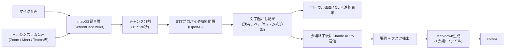

# 概要

ローカルで動かす前提で以下の機能を実装する。

```
会議の文字起こし → タスク分解 → Markdown
```

## 背景・課題感

Notta などの文字起こしSaaSは、

- 使用量に関わらず月額固定費がかかる
- 出力フォーマットが閉じていて、パーソナライズしにくい
- TODO/タスク管理を自分の運用（プロジェクトごとにGitHubでMarkdown管理し、AIに再利用させる）に組み込みにくい

という課題がある。会議を行う端末上でローカルに立ち上げ、STT・LLMは従量課金APIを叩く構成にすることで、固定費をかけずに自分のワークフローに最適化したツールを実現する。

## ゴール

1. Macで再生されるシステム音声とマイク音声を録音する
2. 録音中に音声を短いチャンクへ分割し、準リアルタイムで文字起こしする
3. 会議終了後に文字起こし結果をLLMへ渡し、要約とタスクに分解する
4. 会議ごとにメタ情報付きで出力する
5. 出力先をGitリポジトリとして管理できるようにする
6. STT/LLMプロバイダを抽象化し、固定のベンダーロックインを避ける

## 全体アーキテクチャ



音声は15〜30秒程度のチャンクへ分割し、録音中に順次STTへ渡す。これにより、録音を継続しながら準リアルタイムで文字起こし結果を追加する。会議終了後、全チャンクの文字起こしをまとめてClaude APIへ渡し、要約・タスク抽出とMarkdown出力を行う。

## 主要機能要件

### 1. 音声キャプチャ
- MVPはmacOS 15以降を対象とする
- Macで再生される全システム音声（Zoom / Google Meet / Microsoft Teams等）と、既定のマイク入力を1本の音声チャンクへミックスする
- macOS標準の`ScreenCaptureKit`を利用する
- 録音中に15〜30秒ごとの音声チャンクを生成し、文字起こしキューへ順次渡す

### 2. 文字起こし（STT）
- プロバイダを抽象化し、将来OpenAI / Google Speech-to-Text を切り替え可能にする
- 話者分離（diarization）に対応
  - 第一候補: OpenAI `gpt-4o-transcribe-diarize`
  - 代替: Google Speech-to-Text の `speaker_diarization_config`
- OpenAI STTへ渡す各音声チャンクは25MB以下にする

### 3. タスク分解（LLM）
- Claude API に文字起こし全文を渡し、以下を生成
  - 会議の要約
  - タスク（担当者・期限が読み取れる場合は付与）のチェックボックスリスト
- プロンプトをカスタマイズ可能にし、パーソナライズの中心にする

### 4. 出力（Markdown）
- 1会議 = 1ファイル（要約・タスク・文字起こしは分離せず同一ファイルに含める）
- frontmatter（YAML）にメタ情報を持たせる（日時、会議名、参加者、タグ等）
- AIが後から読み込みやすい構造にする

### 5. Git連携
- 出力先ディレクトリをGitリポジトリとして管理
- ローカルコミット後、可能であればリモートへのpushまで自動化する

## 将来構想: 会議ノートを起点にしたAIアシスト

蓄積したMarkdown会議ノートに対して、過去の会議内容を質問したり、会話しながらノートを修正したりできるようにする。

- ノート横断で質問し、回答とあわせて根拠となる会議ノート・該当箇所を示す
- 「この会議で決まった担当は?」「前回からの宿題は?」のような質問に答える
- 聞き間違いの訂正やタスクの更新を、変更案の確認後にMarkdownへ反映する
- 人名・固有名詞などの訂正を辞書として蓄積し、以降の文字起こし・要約プロンプトへ渡して精度を改善する

モデル自体を再学習しなくても、訂正履歴と会議ノートをコンテキストとして与えることで、個人・チームの運用に適応していく仕組みを目指す。

## 出力フォーマット例

```markdown
---
title: "定例MTG"
date: 2026-08-17
participants: [..., ...]
tags: [meeting, project-...]
---

## 要約
...

## タスク
- [ ] タスク1（担当: ..., 期限: ...）
- [ ] タスク2

## 文字起こし
[話者A] ...
[話者B] ...
```

## 音声ファイルから会議ノートを生成する

バックエンドの依存関係をインストールし、リポジトリ直下の `.env` に
`OPENAI_API_KEY`、`ANTHROPIC_API_KEY`、`CLAUDE_MODEL` を設定してから実行する。
Identity-linked API keyを使う場合は、`ANTHROPIC_WORKSPACE_ID` も設定する。

```sh
cd backend
source .venv/bin/activate
python -m app.cli ../data/meeting.m4a --title "定例MTG" --participant "田中" --tag project-a
```

`NOTES_DIR`（未指定ならリポジトリ直下の `notes/`）にMarkdownファイルが保存される。

`--keep-transcript` を付けると、Markdownに含まれる文字起こしに加えて、デバッグ用の
`.transcript.txt` ファイルも同じディレクトリに保存する。元の音声ファイルは変更しない。

## macOSで録音する

macOS 15以降では、Macのシステム音声と既定マイクをミックスして録音できる。
初回は、ターミナルにマイク・画面収録の権限を許可する。

```sh
cd backend
source .venv/bin/activate
python -m app record --title "定例MTG" --participant "田中" --tag project-a --keep-transcript
```

既定ではリポジトリ直下の`data/recordings_YYYYMMDDHHMM/`へ保存する。録音全体は`recording.wav`として1本にまとめ、逐次文字起こし用の15秒ごとのWAVチャンクは`chunks/`へ分けて保存する。完成したチャンクは連番順にOpenAI STTへ送られ、文字起こし結果がCLIへ追加表示される。`Ctrl+C`で録音を停止すると、取得済みの文字起こし全文から要約・タスクを抽出し、Markdown会議ノートを自動保存する。

チャンクの長さは`.env`の`RECORDING_CHUNK_SECONDS`で設定する（既定: 15秒）。録音先・ノート出力先はそれぞれ`data/`・`NOTES_DIR`に固定する。

発話が含まれないチャンクはSTTへ送らずスキップする。また、画面スリープ・画面ロック・外部ディスプレイの
切断でキャプチャが中断された場合は、無音を録り続けずにその時点で録音を終了し、取得できたぶんから
会議ノートを生成する。

## 途中で落ちた録音から会議ノートを作り直す

録音中の文字起こしは、確定したチャンクごとに録音ディレクトリの`transcript.txt`へ追記される。
要約の生成に失敗した場合や処理を中断した場合は、このファイルから会議ノートを作り直せる。

```sh
cd backend
source .venv/bin/activate
python -m app note ../data/recordings_YYYYMMDDHHMM/transcript.txt --title "定例MTG" --participant "田中"
```

## ローカルAPIを起動する

会議の開始・停止と、保存済み会議ノートの取得をHTTPで扱うローカルAPIを同梱している。

```sh
cd backend
source .venv/bin/activate
pip install -r requirements.txt
python -m app.api
```

`http://127.0.0.1:8000` で待ち受ける。主なエンドポイントは次のとおり。

| メソッド | パス | 用途 |
|---|---|---|
| POST | `/api/meetings` | 録音と逐次文字起こしを開始する |
| GET | `/api/meetings/{id}` | 会議の状態・文字起こしを取得する |
| POST | `/api/meetings/current/stop` | 録音を停止し、要約とMarkdown生成へ進める |
| GET | `/api/notes` | 保存済み会議ノートの一覧を返す |
| GET | `/api/notes/{id}` | 会議ノートのMarkdown本文を返す |

初回の録音開始時は、ターミナルにマイク・画面収録の権限を許可する。

## 技術スタック（方向性）

| 領域 | 選定（方向性） |
|---|---|
| Backend | Python + FastAPI（ローカルAPI） |
| 録音 | macOS標準Framework（ScreenCaptureKit） |
| STT | OpenAI API / Google Speech-to-Text |
| タスク分解LLM | Claude API |

## ディレクトリ構成（案）

```
local-meeting-notes/
├── backend/
│   ├── app/
│   │   ├── main.py
│   │   ├── stt/          # STTプロバイダ抽象化層
│   │   ├── llm/          # タスク分解ロジック
│   │   ├── audio/        # 音声キャプチャ・チャンク処理
│   │   └── output/       # Markdown生成・Git連携
│   └── requirements.txt
├── notes/                 # 出力先
├── .env.example
└── README.md
```
