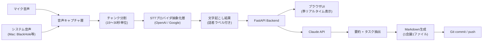

# 概要

ローカルで動かす前提で以下の機能を実装する。

```
会議の文字起こし → タスク分解 → Markdown
```

## 背景・課題感

Notta などの文字起こしSaaSは、

- 使用量に関わらず月額固定費がかかる
- 出力フォーマットが閉じていて、パーソナライズしにくい
- TODO/タスク管理を自分の運用（プロジェクトごとにGitHubでMarkdown管理し、AIに再利用させる）に組み込みにくい

という課題がある。会議を行う端末上でローカルに立ち上げ、STT・LLMは従量課金APIを叩く構成にすることで、固定費をかけずに自分のワークフローに最適化したツールを実現する。

## ゴール

1. 会議中〜終了後に、音声をリアルタイムで文字起こしする
2. 文字起こし結果をLLMに渡し、要約とタスクに分解する
3. 会議ごとにメタ情報付きで出力する
4. 出力先をGitリポジトリとして管理し、pushまで自動化する
5. STT/LLMプロバイダを抽象化し、固定のベンダーロックインを避ける

## 全体アーキテクチャ



処理方式はストリーミングではなく、**チャンク分割バッチ**を採用する。実装コストを抑えつつ、体感としてはほぼリアルタイムの文字起こしを実現する。

## 主要機能要件

### 1. 音声キャプチャ
- マイク音声 + システム音声（相手の声）の両方に対応
- 15〜30秒単位でチャンク分割し、逐次処理

### 2. 文字起こし（STT）
- プロバイダを抽象化し、OpenAI / Google Speech-to-Text を切り替え可能にする
- 話者分離（diarization）に対応
  - 第一候補: OpenAI `gpt-4o-transcribe-diarize`
  - 代替: Google Speech-to-Text の `speaker_diarization_config`
- 音声ファイルは処理後に破棄する（デフォルト）。保持したい場合はオプションで切替可能にする

### 3. タスク分解（LLM）
- Claude API に文字起こし全文を渡し、以下を生成
  - 会議の要約
  - タスク（担当者・期限が読み取れる場合は付与）のチェックボックスリスト
- プロンプトをカスタマイズ可能にし、パーソナライズの中心にする

### 4. 出力（Markdown）
- 1会議 = 1ファイル（要約・タスク・文字起こしは分離せず同一ファイルに含める）
- frontmatter（YAML）にメタ情報を持たせる（日時、会議名、参加者、タグ等）
- AIが後から読み込みやすい構造にする

### 5. Git連携
- 出力先ディレクトリをGitリポジトリとして管理
- ローカルコミット後、可能であればリモートへのpushまで自動化する

## 出力フォーマット例

```markdown
---
title: "定例MTG"
date: 2026-08-17
participants: [..., ...]
tags: [meeting, project-...]
---

## 要約
...

## タスク
- [ ] タスク1（担当: ..., 期限: ...）
- [ ] タスク2

## 文字起こし
[話者A] ...
[話者B] ...
```

## 技術スタック（方向性）

| 領域 | 選定（方向性） |
|---|---|
| Backend | Python (FastAPI) |
| Frontend | 未定 |
| STT | OpenAI API / Google Speech-to-Text |
| タスク分解LLM | Claude API |

## ディレクトリ構成（案）

```
local-meeting-notes/
├── backend/
│   ├── app/
│   │   ├── main.py
│   │   ├── stt/          # STTプロバイダ抽象化層
│   │   ├── llm/          # タスク分解ロジック
│   │   ├── audio/        # 音声キャプチャ・チャンク処理
│   │   └── output/       # Markdown生成・Git連携
│   └── requirements.txt
├── frontend/              # 未定
├── notes/                 # 出力先
├── .env.example
└── README.md
```

## セットアップ注意事項（Mac）

システム音声（会議相手の声）を録音するには、標準のOS機能だけでは取得できないため、BlackHole 等の仮想オーディオデバイスを別途インストール・設定する必要がある。